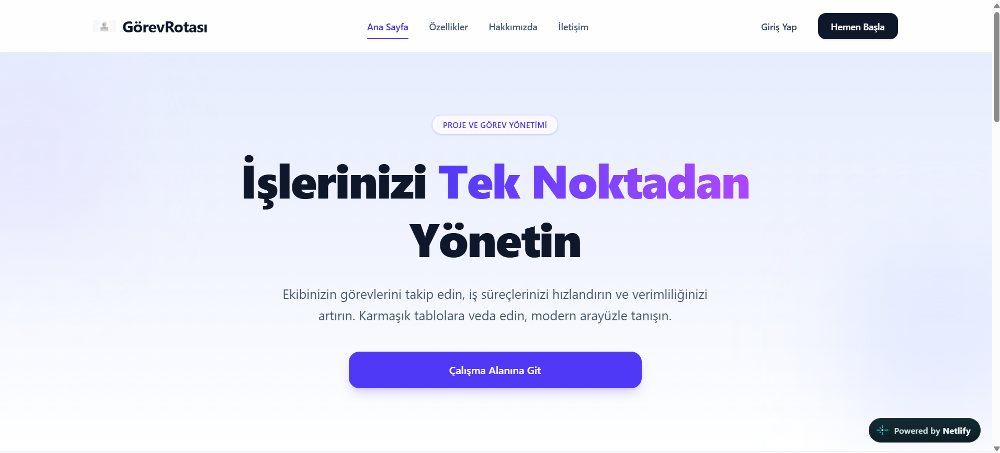
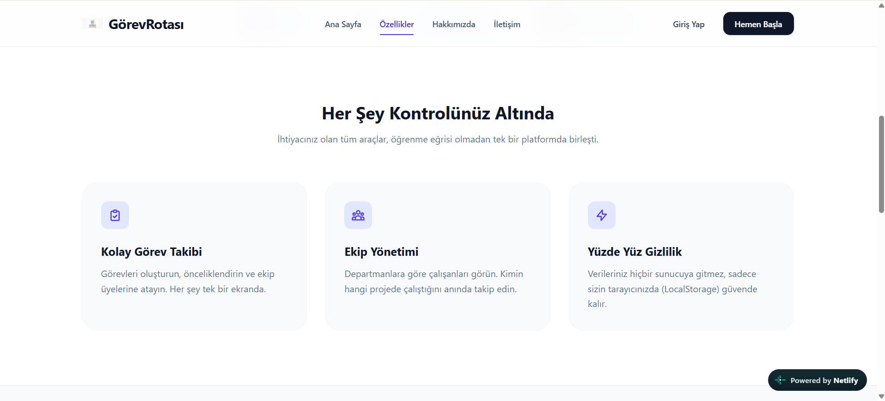
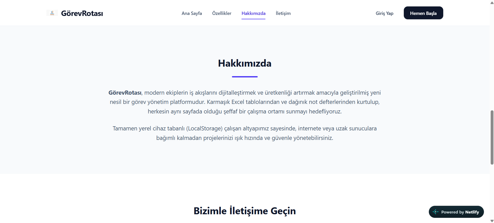
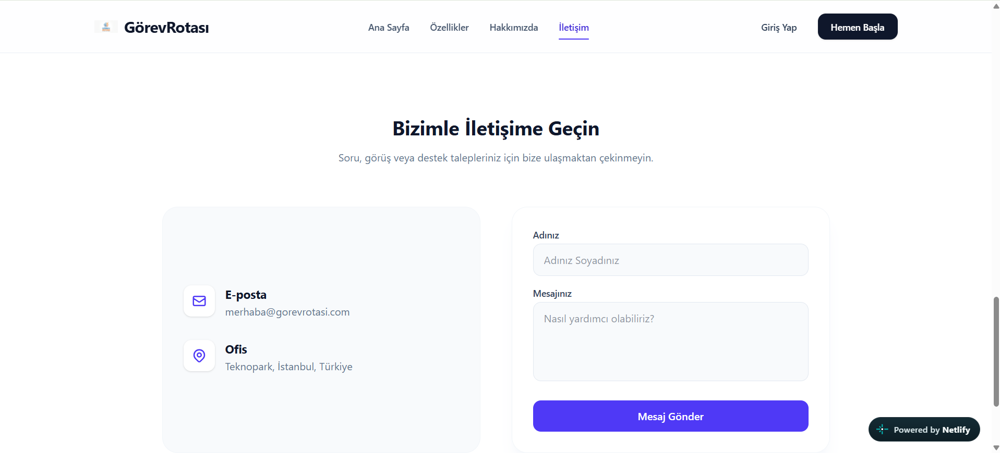
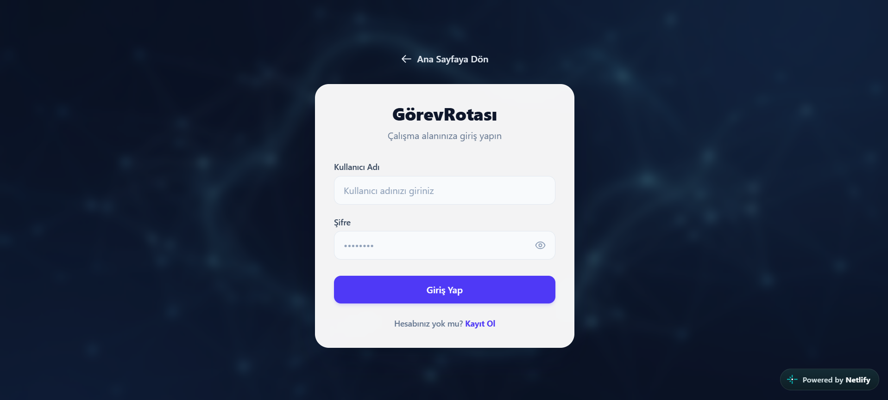
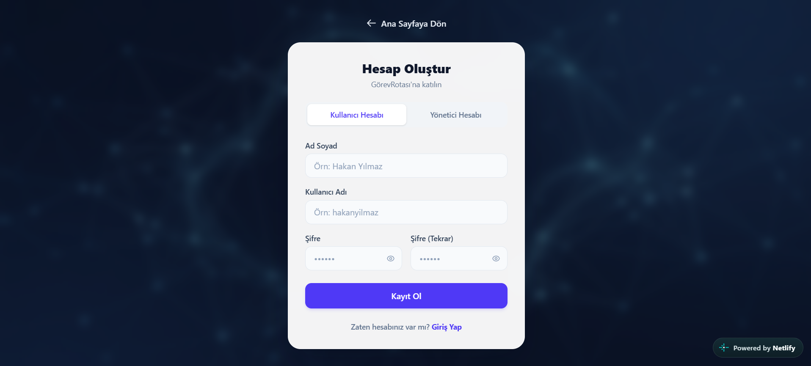
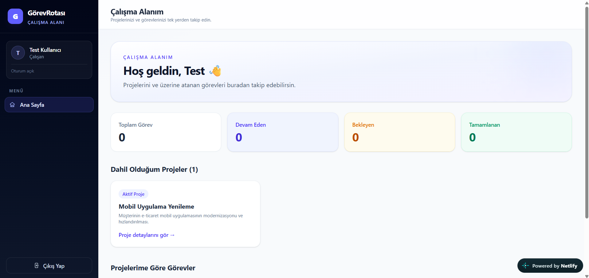
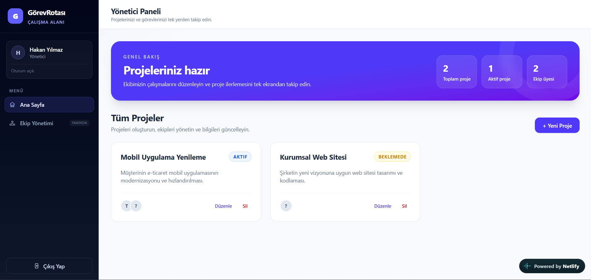
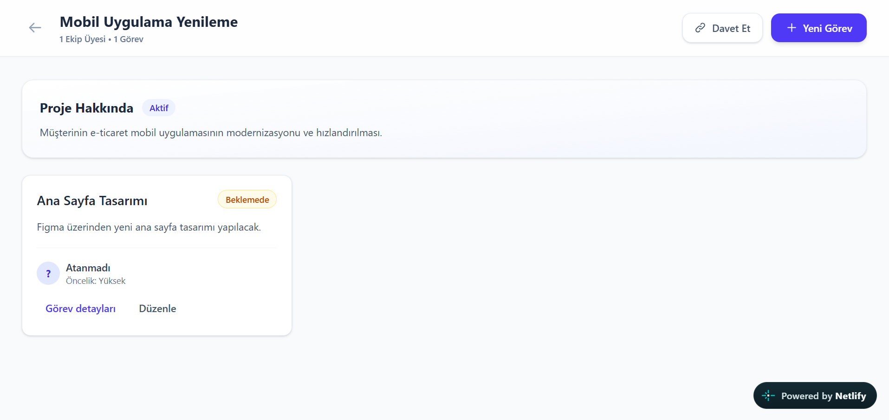
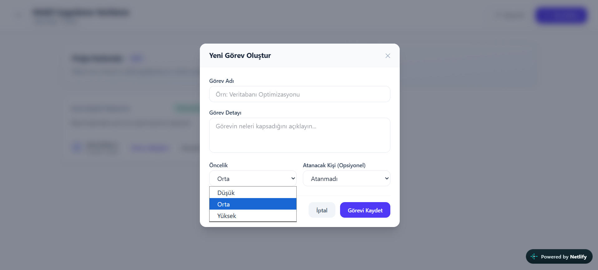

# Tnc-WebProjects

Bu repository, ekiplerin projelerini ve görevlerini takip etmesi için geliştirilen **GörevRotası** uygulamasını içerir. Uygulama; tanıtım sayfalarının yanı sıra çalışan ve yönetici panelleri üzerinden proje ve görev yönetimi sunar.

## Canlı Uygulama

[GörevRotası'nı aç](https://gorevrotasi.netlify.app)

## Ekran Görüntüleri

| Ana Sayfa | Özellikler |
| --- | --- |
|  |  |

| Hakkımızda | İletişim |
| --- | --- |
|  |  |

| Giriş Yap | Kayıt Ol |
| --- | --- |
|  |  |

| Çalışan Paneli | Yönetici Paneli |
| --- | --- |
|  |  |

| Proje Detayları | Görev Ekleme |
| --- | --- |
|  |  |

## Yerelde Çalıştırma

```bash
git clone https://github.com/KayliAli/Tnc-WebProjects.git
cd Tnc-WebProjects/TaskProject-Management
npm install
npm run dev
```

Projenin ayrıntıları için [TaskProject-Management README](./TaskProject-Management/README.md) dosyasına bakın.
